<p align="center">
  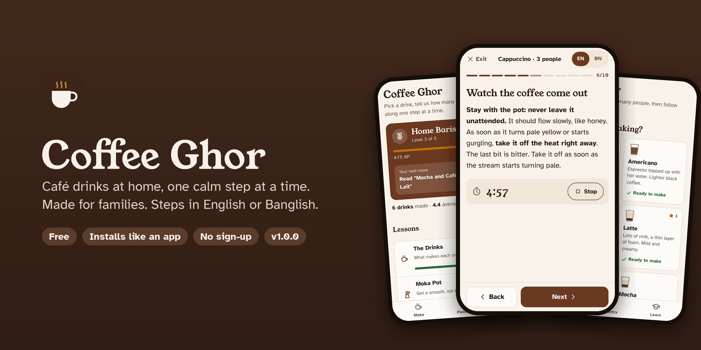
</p>

<p align="center">
  <a href="https://coffee-ghor.vercel.app"><b>Open the app</b></a> &nbsp;·&nbsp;
  <a href="#-put-it-on-your-phone">Install on your phone</a> &nbsp;·&nbsp;
  <a href="CHANGELOG.md">Changelog</a> &nbsp;·&nbsp;
  <b>Version 1.1.0</b>
</p>

<p align="center">
  
  
  
  
  
</p>

---

## ☕ Why this exists

At home we have a moka pot, a milk frother and a family that loves a good cup. We kept wondering why the coffee came out bitter one day and watery the next.

Café recipes assume café machines. Ours is a stovetop pot that makes 300 ml, a frother that runs on batteries, and a jug that holds 350 ml. So we built the guide we wished we had:

- **It does the maths.** Tell it how many people. It works out the water, the coffee, the milk and how many times to brew, for *your* pot and *your* jug.
- **It stays with you.** One big, clear step per screen, with a timer when you need one. No scrolling through a wall of text with wet hands.
- **It helps you get better.** Everyone rates their own cup. If something was off, it tells you exactly what to change next time.
- **It speaks your language.** Flip any step to **Banglish** with one tap. My mom knows what a latte is. She just reads the steps better in Bangla.

No account. No ads. No server. Your progress lives on your phone.

---

## 📱 A quick look

<table>
  <tr>
    <td align="center" width="25%">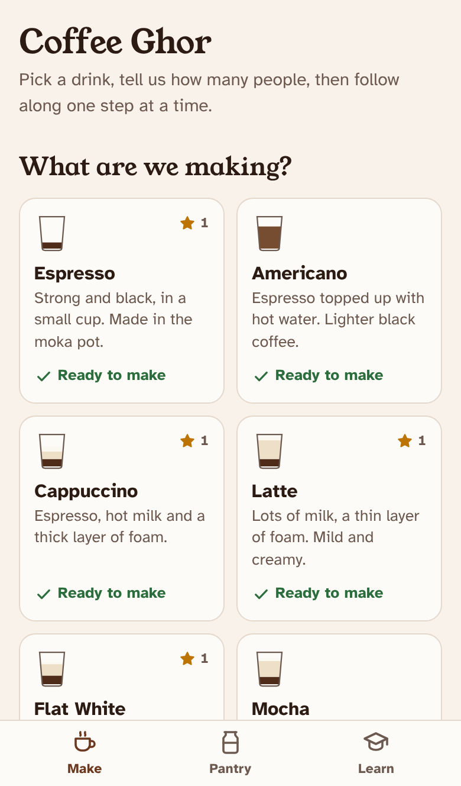<br><sub><b>Pick a drink</b></sub></td>
    <td align="center" width="25%">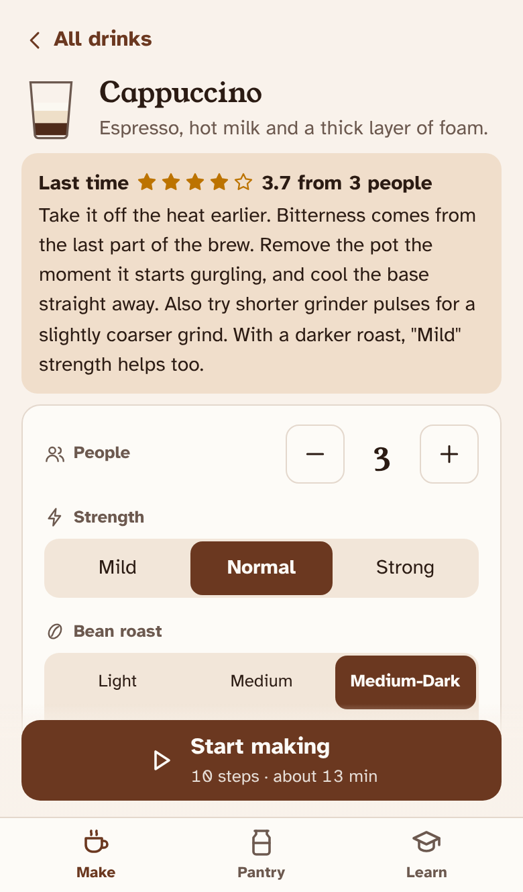<br><sub><b>Set it up</b></sub></td>
    <td align="center" width="25%">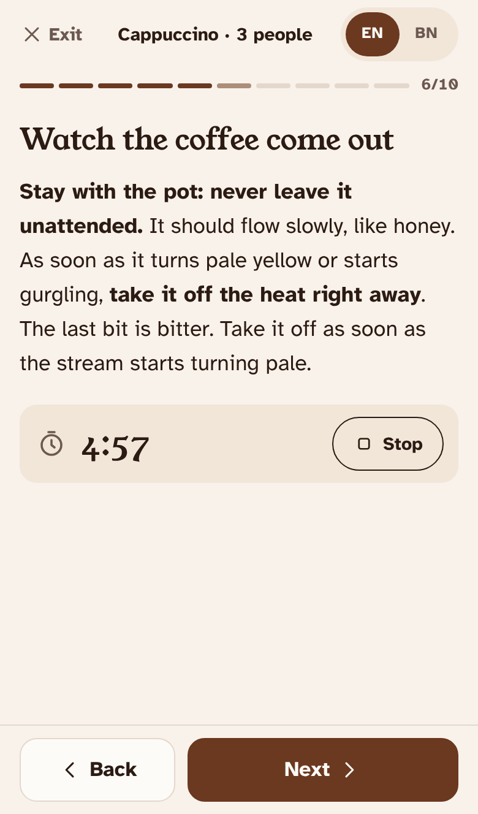<br><sub><b>Make it, step by step</b></sub></td>
    <td align="center" width="25%">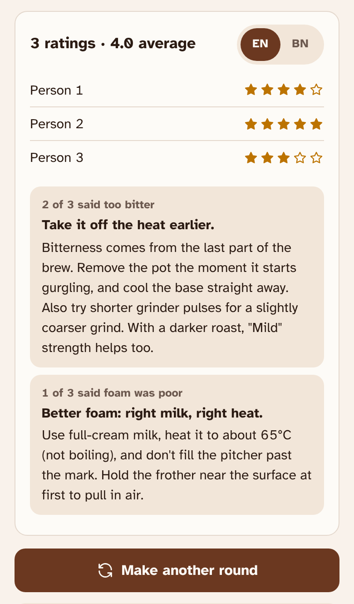<br><sub><b>Rate it, fix it</b></sub></td>
  </tr>
</table>

---

## ✨ Features

### 1. Your kitchen, set up in 30 seconds

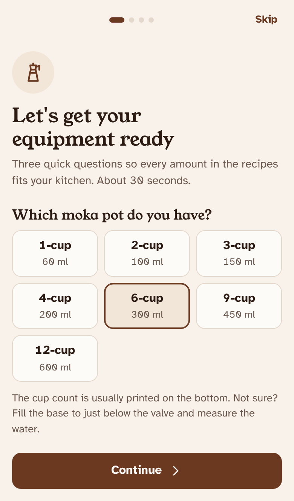

The first time you open the app it asks three quick questions: **Let's get your equipment ready.**

- **Moka pot size:** 1, 2, 3, 4, 6, 9 or 12 cup. This sets how much water and coffee go in each brew.
- **Grinder:** electric, manual or none. The grinding step changes to match: short pulses, a number of turns, or ready ground coffee.
- **Milk pitcher:** 350, 500, 600 or 1000 ml. This sets the fill marks for frothing and how many batches you need.

Change any of it later in **Pantry** and every recipe updates straight away.

<br clear="right">

---

### 2. Fourteen drinks, with names you already know

**Hot:** Espresso · Italian Moka · Americano · Cappuccino · Latte · Flat White · Mocha · Café au Lait

**Cold:** Iced Latte · Iced Mocha · Whipped Coffee

**Frappes:** Butterscotch · Dark Chocolate · Cookies & Creme

**Italian Moka** is made the way Italian homes have done it since 1933: cold water, low heat, off at the first gurgle, and a *cremina* of sugar whipped with the first drops of coffee. **Frappes** chill the coffee first, then blend it with milk and ice until thick and frosty.

Pick a drink, then choose:

- **People:** from 1 up. The app works out how many brews that takes.
- **Strength:** Mild, Normal or Strong. It always stays inside the drink's proper café ratio, so a Strong Latte is still a latte.
- **Bean roast:** Light to Dark. The grind and timing advice adjusts.
- **Sugar:** None to Extra.

Each drink card shows **Ready to make** when your Pantry has everything, and your best rating so far.

<br>

<table>
  <tr>
    <td align="center" width="50%"><br><sub>Light mode</sub></td>
    <td align="center" width="50%">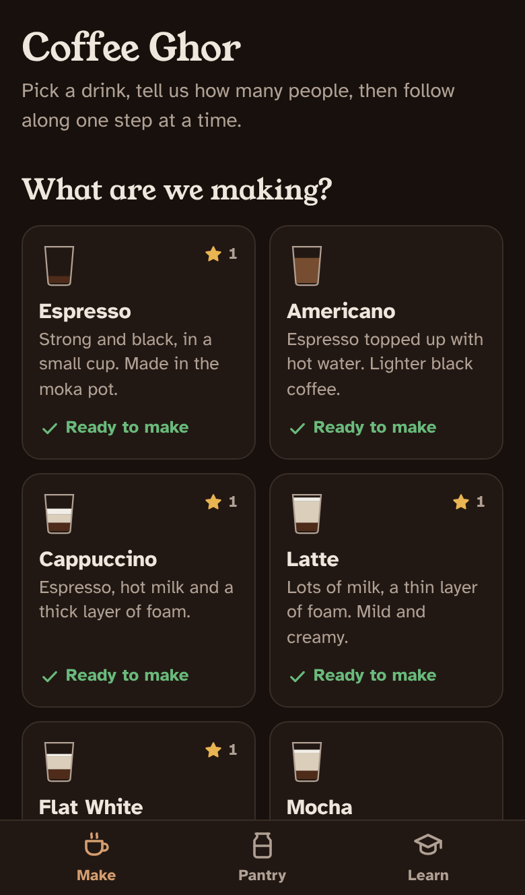<br><sub>Dark mode</sub></td>
  </tr>
</table>

---

### 3. Step by step, in English or Banglish

<table>
  <tr>
    <td align="center" width="50%"><br><sub><b>EN</b></sub></td>
    <td align="center" width="50%">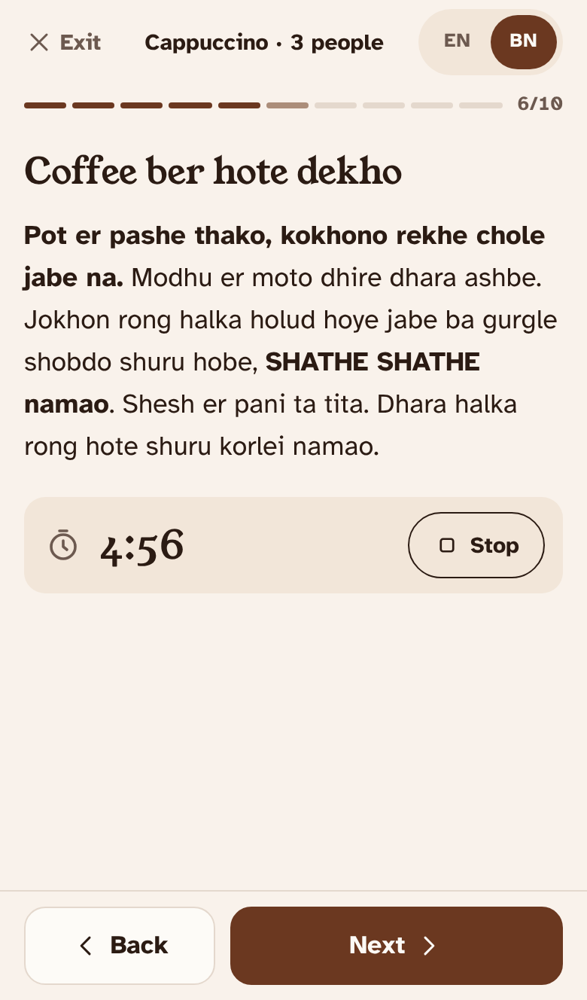<br><sub><b>BN</b></sub></td>
  </tr>
</table>

This is the heart of the app. Instead of one long recipe, you get **one step per screen**:

- A **progress bar** so you always know how far along you are.
- Big **Back** and **Next** buttons, or just swipe.
- **Built-in timers** for the parts that need watching, like the moka pot brew.
- **The screen stays awake** while you cook. No unlocking with coffee on your fingers.
- **Leave and come back.** It remembers which step you were on.
- **EN | BN switch** at the top. Steps and advice switch to Banglish. Drink names stay in English on purpose.

The order follows how a real barista works: kettle on first, grind while the water heats, brew, cool the base, then heat and froth the milk right before serving so nothing sits around going cold.

---

### 4. Everyone at the table rates their own cup

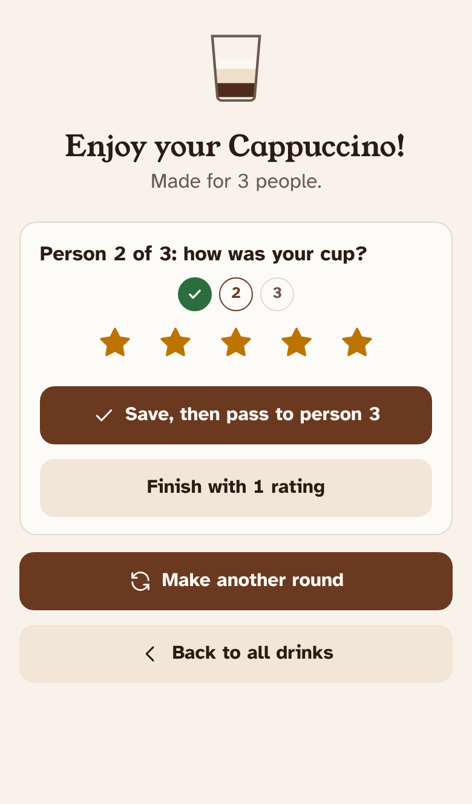

Made coffee for three? Pass the phone around. **Person 1, Person 2, Person 3**, each gives their own stars and can say what was off:

- Too bitter
- Sour or thin
- Too weak
- Burnt taste
- Foam was poor
- Too sweet, or not sweet enough

The app then shows **a real fix for each problem**, written for your exact grinder and roast. For example: *"Take it off the heat earlier. Try shorter grinder pulses for a slightly coarser grind."*

Forgot to rate? No problem. Drinks you skipped wait for you in **Learn**, and you can rate them later.

<br clear="right">

---

### 5. Learn, earn XP and level up

<table>
  <tr>
    <td align="center" width="33%">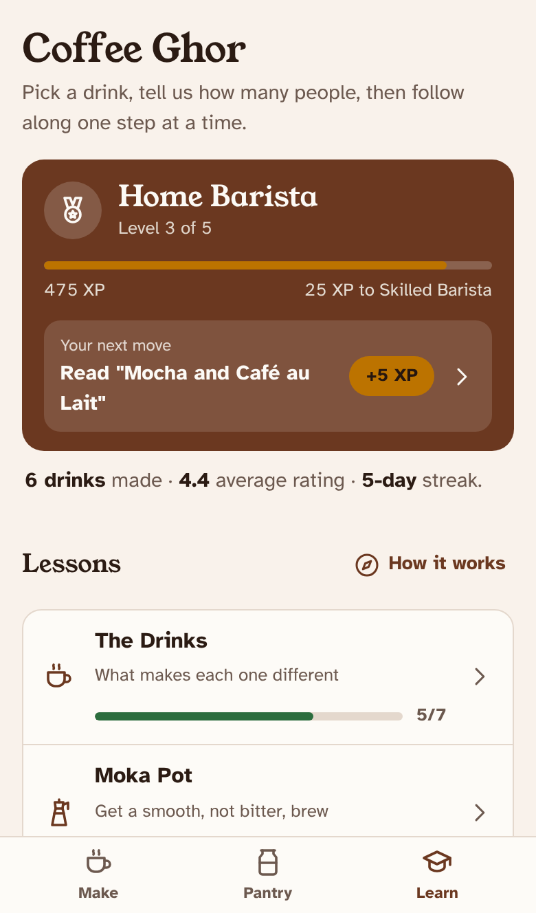<br><sub>Your level and next move</sub></td>
    <td align="center" width="33%">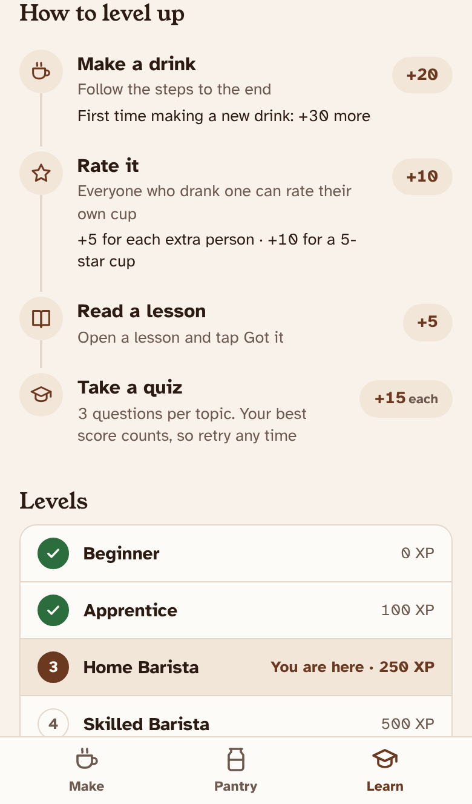<br><sub>How XP works</sub></td>
    <td align="center" width="33%">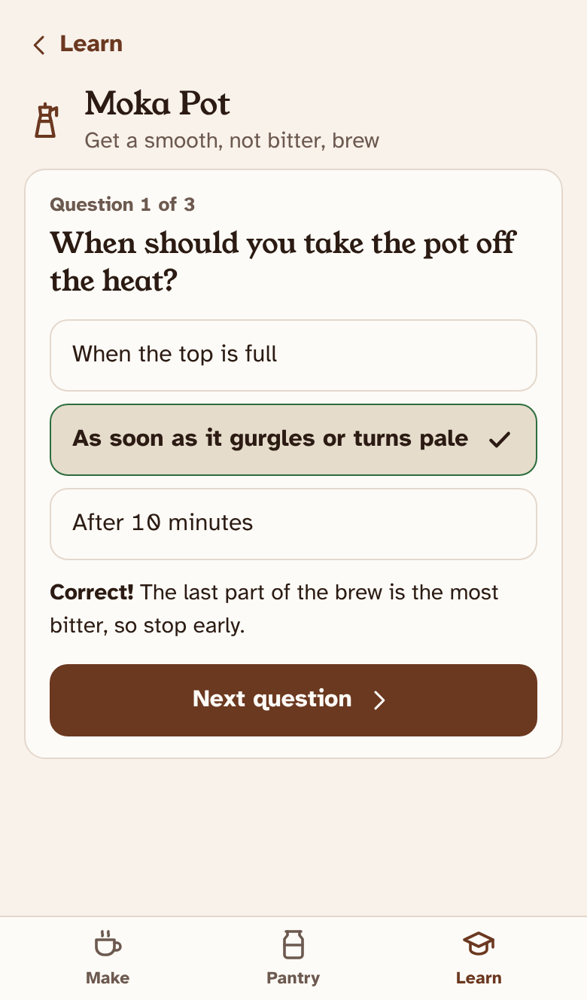<br><sub>Quick quizzes</sub></td>
  </tr>
</table>

Getting better at coffee should feel like a game, not homework.

- **5 topics:** The Drinks, Moka Pot, Beans & Grinding, Milk & Foam, and Safety. Short lessons, then a 3 question quiz.
- **5 levels:** Beginner, Apprentice, Home Barista, Skilled Barista, Coffee Master.
- **10 badges** and a **day streak** for coming back.
- **"Your next move"** always tells you the single best thing to do to level up.

**How you earn XP**

| Do this | Get |
|---|---|
| Make a drink, start to finish | **+20** |
| Make a drink you've never made before | **+30** more |
| Rate it | **+10** |
| Each extra person who rates | **+5** |
| Anyone gives it 5 stars | **+10** |
| Read a lesson | **+5** |
| Get a quiz answer right | **+15** |

---

### 6. Pantry: what you have shapes what you make

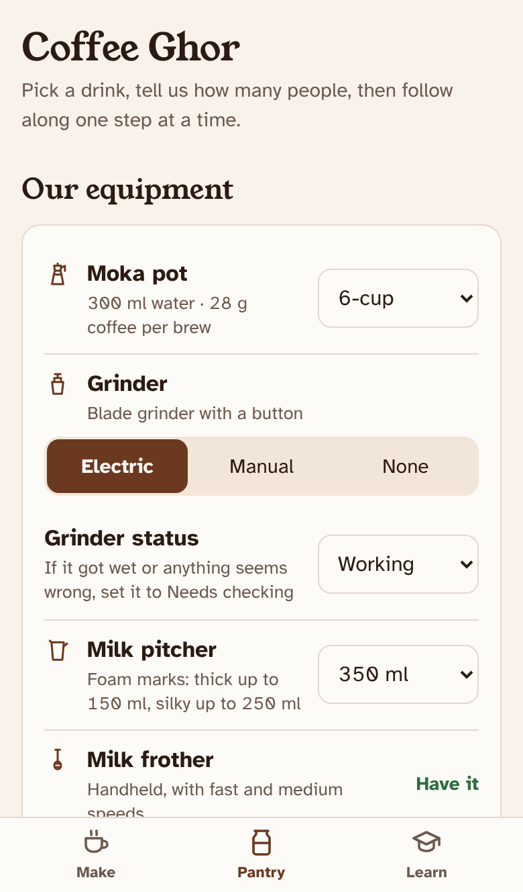

Tick off what's in your kitchen: beans or ground coffee, milk, sugar, cocoa, ice, condensed milk, a kettle, a scale, a thermometer, a flask, a blender, butterscotch sauce, chocolate cookies, whipped cream, cinnamon and vanilla.

The steps quietly adapt. Have a scale? You get grams. No scale? You get tablespoons. No kettle? It has you heat the water in a pot.

Your equipment lives here too: moka pot size, grinder type and whether it works, milk pitcher, and frother.

<br clear="right">

---

### 7. 📲 Put it on your phone

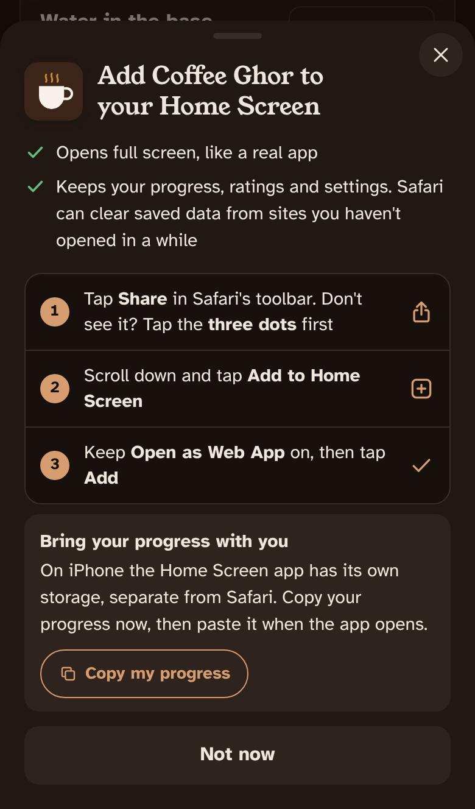

Coffee Ghor installs like a real app, with its own icon, full screen and no browser bars.

The app spots your device and shows the right steps:

- **iPhone (Safari):** Share, then *Add to Home Screen*.
- **Android (Chrome):** one tap install when your phone supports it, or the menu steps if not.
- **Inside Instagram, Facebook and similar apps:** it tells you to open it in your real browser first.

You can close the prompt with the **✕** and find it again in Pantry any time.

**Moving to a new phone?** Pantry has **Copy my progress**. Paste the code on the other phone and your level, ratings and settings come with you.

<br clear="right">

---

## 🧭 Your first five minutes

1. Open **[coffee-ghor.vercel.app](https://coffee-ghor.vercel.app)** on your phone.
2. Answer the three equipment questions.
3. Add it to your Home Screen when it asks (or tap ✕ to skip).
4. Pick a drink, choose how many people, tap **Start making**.
5. Follow the steps. Rate your cup. Watch your XP go up.

---

## 🛠 Tech stack

Coffee Ghor is deliberately simple. **The whole app is one file.** No framework, no build step, no backend, no tracking.

| Layer | What we use | Why |
|---|---|---|
| **App** | One `index.html` with HTML, CSS and plain JavaScript | Opens instantly, easy to read, nothing to install or compile |
| **Data** | The browser's `localStorage` | Your progress stays on your phone. No accounts, no server |
| **Install** | Web app manifest, Apple touch icon, PNG icons | Adds to the Home Screen and opens full screen like a native app |
| **Screen** | Screen Wake Lock API | Keeps the screen on while you're cooking |
| **Design** | OKLCH colour tokens with light and dark mode | Warm coffee tones that stay readable in both modes |
| **Type** | Young Serif for headings, Atkinson Hyperlegible for text | Friendly headings, and body text built for easy reading |
| **Sizing** | iOS type scale (17 px body), 44 px touch targets | Feels at home on an iPhone and is easy to tap |
| **Icons** | Hand drawn inline SVG set | Sharp at any size, no icon library to load |
| **Hosting** | Vercel, linked to this GitHub repo | Every push to `main` goes live in seconds |
| **Testing** | Node.js and Playwright (headless Chromium) | Checks every recipe and every screen automatically |

### How the code is organised

Everything lives in `index.html`, top to bottom:

- **Settings:** moka pot table (`MOKA`), pitcher sizes, grinder types, and the default state.
- **Recipes:** `RECIPES` holds the 14 drinks and their ratio limits. `plan()` does the maths. `buildSteps()` writes the steps in English and Banglish.
- **Ratings and advice:** `ISSUES` and `advice()` turn "too bitter" into a fix that fits your grinder and roast.
- **Learn:** `CATS` holds the lessons and quizzes. `LEVELS`, `BADGES` and `reward()` run the XP system.
- **Screens:** small `render*` functions draw each view. One click handler routes every tap using `data-*` attributes.

---

## ✅ How we keep the recipes honest

Every change runs through two automatic checks in a real headless browser.

**Recipe check:** `tests/coffee-eval.js`

Tries **every drink** with every mix of people, strength, roast, sugar, kitchen tools, moka pot size, pitcher size and grinder type. That's **12,096 combinations**, each checked against **30 coffee rules**:

- Café ratios for every drink
- Kettle on before grinding, milk heated right before frothing
- Never overfill the pitcher or the grinder
- Safe moka pot handling, including "never leave it unattended"
- Unsweetened cocoa warnings for mochas
- Italian Moka: cold water, low heat, and a cremina only when there is sugar
- Frappes: coffee chilled before blending, never more than 3 drinks in the blender
- English and Banglish steps say the same numbers

Current score: **100%**.

**Layout check:** `tests/spacing-check.js`

Opens every screen and pop-up at 375 px and 430 px wide, in light and dark mode, and flags any text that touches or spills past the edge of its box. Current result: **0 problems**.

```bash
npm i -D playwright
node tests/coffee-eval.js index.html
node tests/spacing-check.js index.html
```

---

## 🚀 Run it yourself

There is nothing to build.

```bash
git clone https://github.com/mahtabmashuq/Coffee-ghor.git
cd Coffee-ghor
npx serve .        # or just open index.html in a browser
```

**Deploy:** the Vercel project is linked to this repo.

- Push or merge to `main` and it goes live at https://coffee-ghor.vercel.app
- Push to any other branch for a preview link (needs a Vercel login to view)

---

## 🗓 Releases

| Version | What shipped |
|---|---|
| **1.1.0** | Italian Moka with cremina; Butterscotch, Dark Chocolate and Cookies & Creme Frappes; blender in Pantry |
| 1.0.0 | First full release: spacing fixes across the app, version shown in Pantry, new README |
| 0.8.0 | Equipment setup on first open, recipes that follow your equipment, a rating for every cup, level-up guide |
| 0.7.0 | Standard iOS text sizes; rate drinks later |
| 0.6.0 | Every recipe refined to café standards, plus the automatic recipe check |
| 0.5.0 | Full design pass, iPhone status bar fix, Learn intro, Home Screen prompt, progress transfer |
| 0.4.0 | Learn tab with XP, levels and badges; ratings with fixes; bigger Pantry |
| 0.3.0 | Guided flow: pick a drink, set it up, then one step at a time |
| 0.2.0 | Plain English, standard drink names, redesign, installable on iPhone |
| 0.1.0 | The first version: a Banglish family coffee guide |

Every detail is in the **[changelog](CHANGELOG.md)**.

---

<p align="center">
  Made with love, and a lot of test coffee, for the family.<br>
  <b>Ghor</b> means <i>home</i>. ☕
</p>
